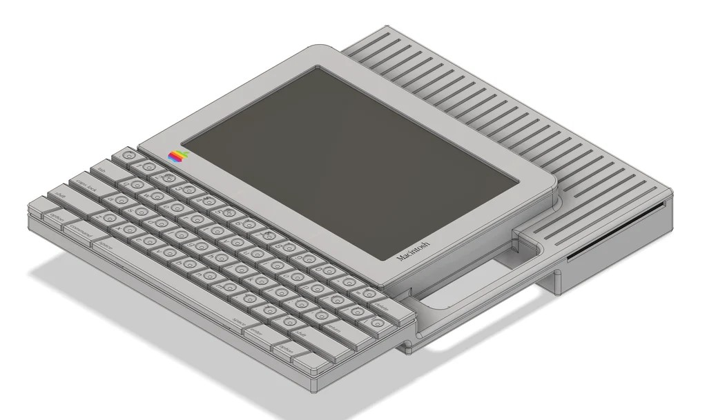
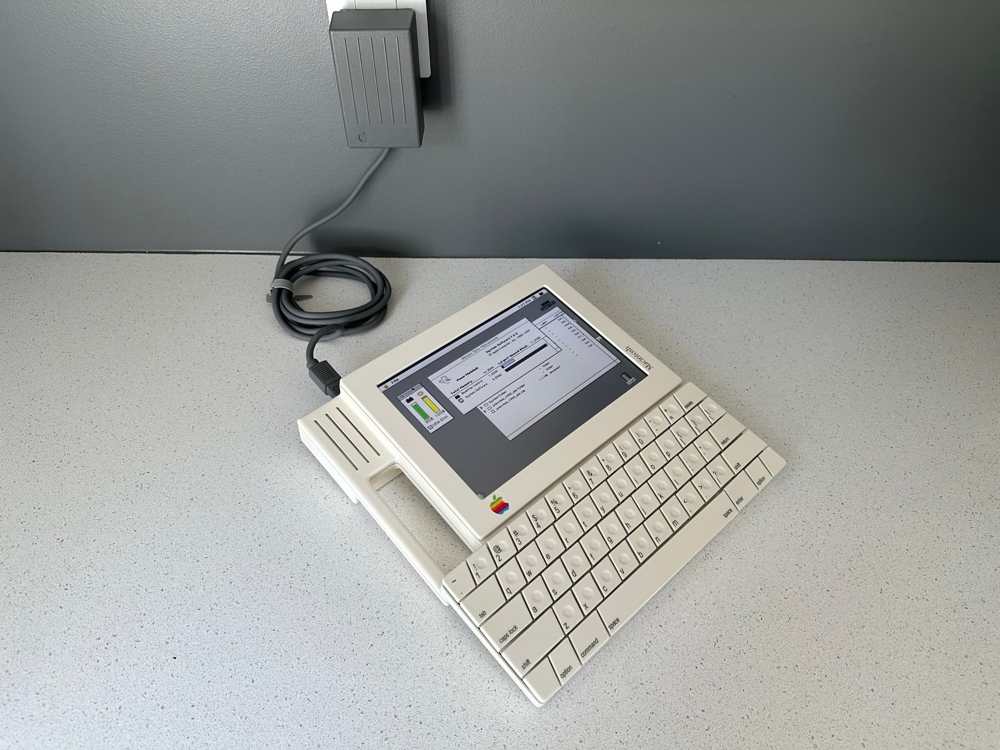
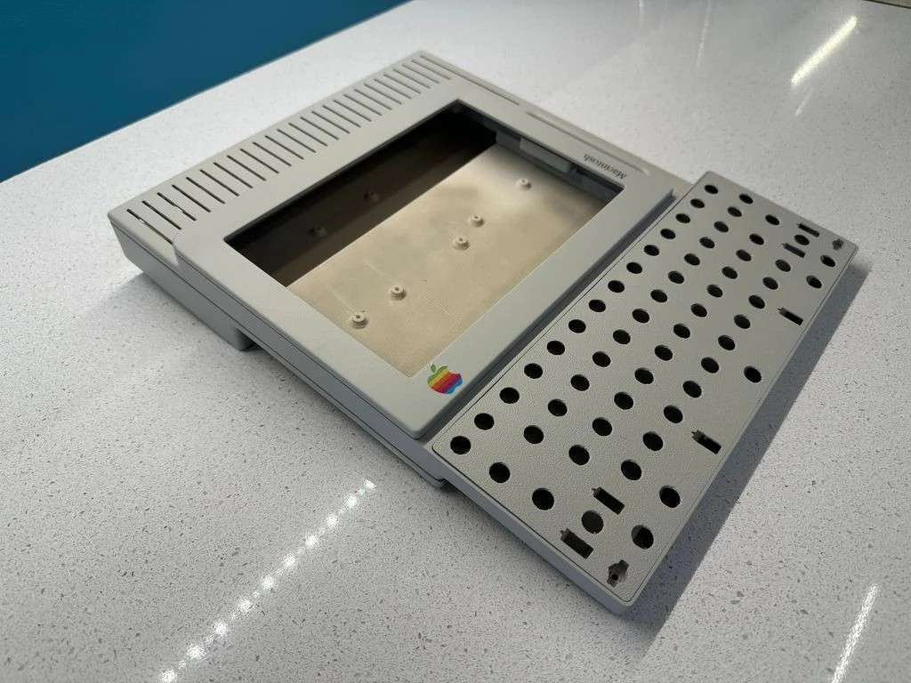
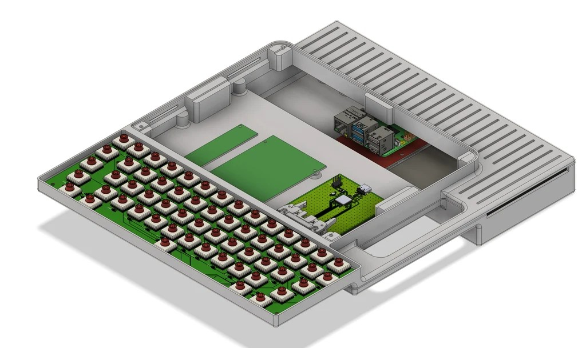
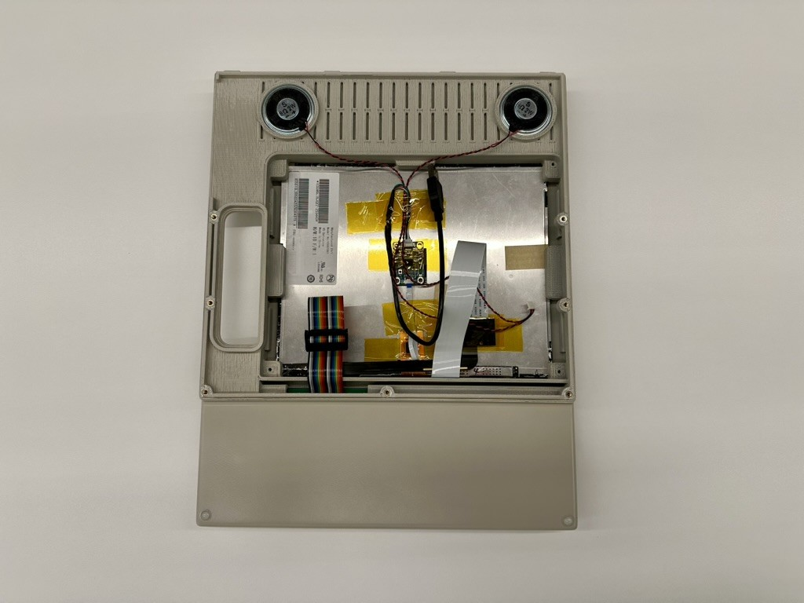
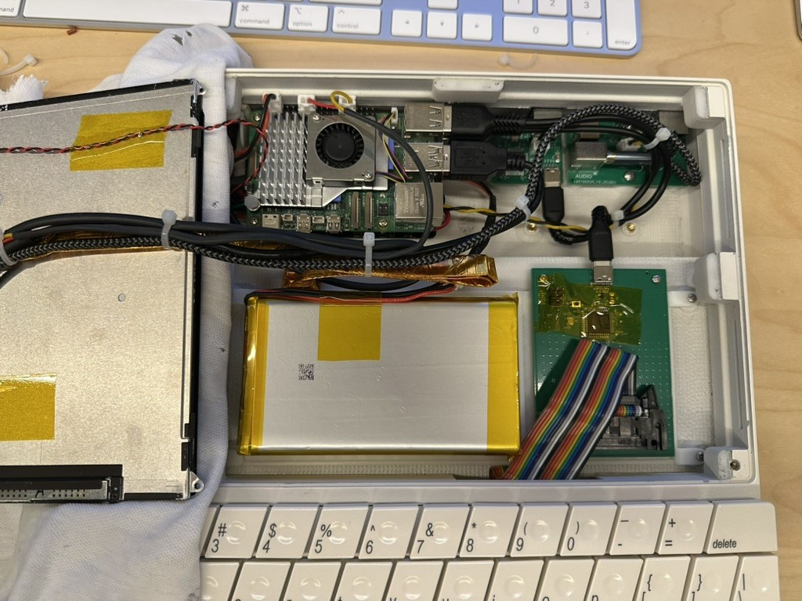
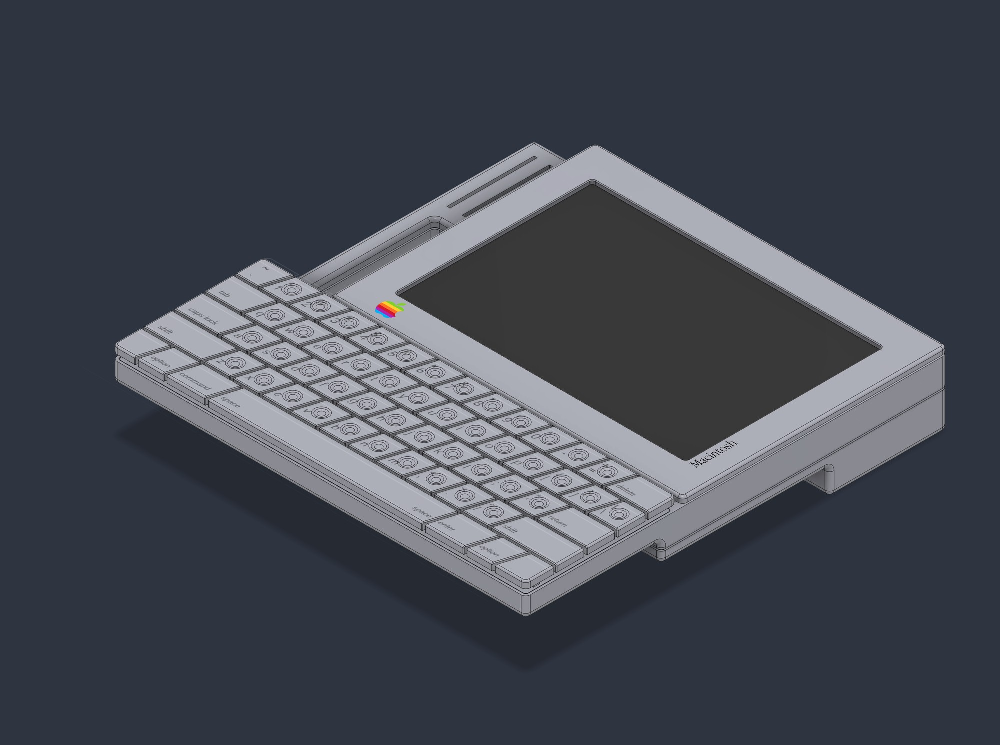
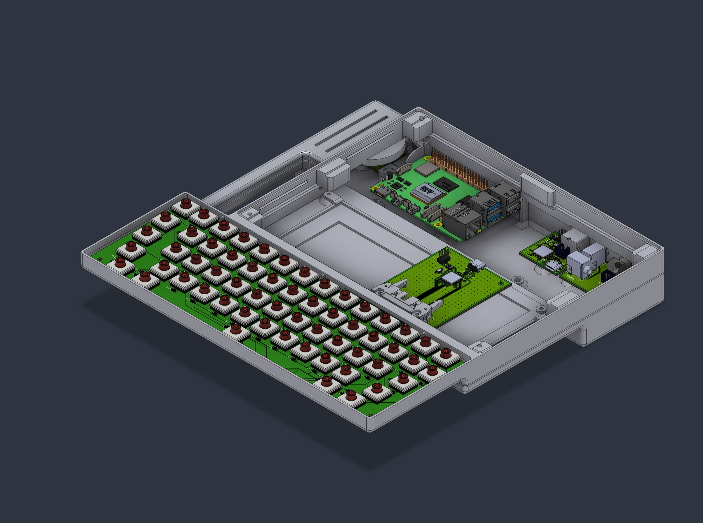

# BookMac Replicas

Functional replicas of the BookMac and BookMac Mini, the 1985 tablet concepts Hartmut Esslinger (frog design) created for Apple. Esslinger's own *Keep It Simple* calls them the MacBook and MacBook Mini. Each unit is built around a Raspberry Pi 5 with a 9.7" 2048×1536 touchscreen, an internal mechanical keyboard, a battery-backed power system and period-style rear ports. Their main use is classic Mac OS (7.5.5) under SheepShaver, but they are general-purpose Pi 5 computers and run other operating systems and emulators, including Basilisk II.

There are two units, one per concept: the full-size **BookMac** and the smaller **BookMac Mini**. They share most of the hardware and all of the software; the differences are listed in `docs/` and `decals/README.md`.

The full-size concept has a floppy drive slot. This build closes it with a printed cover (`enclosure/bookmac/floppy-slot-cover.stl`), because the space behind it holds the batteries, rear ports and speakers. The Mini concept shows no floppy provision.

Both concepts are documented in Paul Kunkel, *AppleDesign* (Graphis, 1997), and Hartmut Esslinger, *Keep It Simple* (Arnoldsche, 2013). The build was inspired by Kevin Noki's functional replicas.

> **Work in progress.** This repository documents a personal build as it evolves. Expect inaccuracies, undocumented changes, and parts of the documentation that lag behind the hardware. Verify dimensions, pinouts and part numbers against your own parts before building, and please open an issue when you find an error.

> **Hobbyist designs, reference only.** The PCBs, wiring and enclosure were designed by a hobbyist, not a professional electrical or mechanical engineer. They have not been independently reviewed for electrical safety, battery safety, thermal performance or regulatory compliance. Use them as a reference for your own work, at your own risk. This is especially important for anything involving the lithium battery packs or the UPS.

> **Not affiliated with, sponsored by, or endorsed by Apple Inc.** Apple and Macintosh are trademarks of Apple Inc., used here only to identify the original concept this replica is based on. This repository contains no Apple logos or artwork.

---

## Repository contents

| Folder | Contents |
|---|---|
| `pcb/keyboard/` | 58-key matrix PCB (Cherry MX Low Profile footprint, 5 × 14): `.sch`, `.brd`, BOM, CPL |
| `pcb/keyboard-controller/` | ATmega32U4 USB-C keyboard controller: `.sch`, `.brd`, BOM, CPL |
| `pcb/rear-port-adb/` | ATmega32U4 ADB-to-USB converter (TMK) with Mini-DIN 4: `.sch`, `.brd`, BOM, CPL |
| `pcb/rear-port-power/` | Rear power and reset switch board: `.sch`, `.brd`, BOM, CPL |
| `pcb/rear-port-av/` | Composite RCA, 3.5 mm headphone pass-through, Mini-DIN 8: `.brd`, BOM, CPL |
| `firmware/keyboard/` | QMK keyboard definition, keymap and pre-built image for the internal keyboard |
| `firmware/adb/` | Pre-built TMK `adb_usb` unimap image for the ADB converter, with a link to the source |
| `enclosure/bookmac/` | Full-size STEP model and STLs, one file per part |
| `enclosure/bookmac-mini/` | Mini STEP model and STLs, one file per part |
| `enclosure/jigs/` | Keycap holder and keycap decal holder |
| `decals/` | Keycap legend decals for both units, 1:1 exports of the original artwork (SVG with outlined text, and PDF), and a README listing the differences |
| `docs/` | Components list and wiring, Pi 5 pinout, PiPower 5 installation, reference photos (`docs/images/`) |

Board files are EAGLE 9.7 format, exported from Autodesk Fusion Electronics.

Gerber packages for each board revision are attached to the GitHub Releases rather than committed.

## Related software

The Pi-side software lives in separate repositories:

| Repository | Purpose |
|---|---|
| [emulator-manager](https://github.com/spc6486/emulator-manager) | Tray launcher for SheepShaver / Basilisk II; touch shim, display geometry |
| [battery-monitor](https://github.com/spc6486/battery-monitor) | PiPower 5 (I2C) battery monitoring and safe shutdown |
| [emu-serial-bridge](https://github.com/spc6486/emu-serial-bridge) | Serial bridge between the emulated Mac and Pi-side handlers (battery, brightness, volume) |
| [emu-control-strip](https://github.com/spc6486/emu-control-strip) | Native Mac OS 7.5 Control Strip modules, Brightness control panel, Power Manager extension |
| [emu-homecontrol](https://github.com/spc6486/emu-homecontrol) | Classic Mac OS Home Assistant client |
| [brightness-control](https://github.com/spc6486/brightness-control) | Backlight brightness via Pi 5 hardware PWM |
| [volume-control](https://github.com/spc6486/volume-control) | Volume, mute and GPIO headphone/speaker toggle |
| [display-calibrator](https://github.com/spc6486/display-calibrator) | Display borders and touchscreen calibration for custom bezels |
| [kiosk-manager](https://github.com/spc6486/kiosk-manager) | Kiosk mode, boot splash and startup sound |

## Hardware overview

| Area | Parts |
|---|---|
| Compute | Raspberry Pi 5 |
| Display | 9.7" iPad Retina LCD, LTL097QL01-A01 (2048 × 1536), in both units. Full-size: VSDISPLAY VS-RTD2556HC-V2 controller. Mini: PCB800869. Each controller comes with a TLT-iPAD3 eDP adapter. |
| Touch | SingWon capacitive overlay, USB |
| Backlight | Controller's PWM output separated from the backlight DIM line, which is then driven from Pi GPIO12 (hardware PWM). See [display controller modifications](docs/components-and-wiring.md#4-display-controller-modifications). |
| Audio | Display controller's amplifier and speakers; GPIO24 switches speaker / headphones through the jack-detect line (same section) |
| Power | SunFounder PiPower 5 UPS, two 3.7 V LiPo packs in 2S, 12 V barrel input. Observed runtime is about 3–6 h. |
| Keyboard | Custom 58-key PCB, Cherry MX Low Profile switches, Gateron low-profile plate-mount stabilizers, QMK controller |
| Rear ports | 12 V DC, ADB, headphone, composite (RCA), Mini-DIN 8 |

A full components list with wiring is in `docs/`.

## Photos and reference images

<table>
<tr><td width="50%" valign="top"> Finished full-size BookMac</td><td width="50%" valign="top"> Painted full-size case</td></tr>
<tr><td width="50%" valign="top"> Rendering of the full-size internal layout</td><td width="50%" valign="top"> Full-size internal layout, current wiring</td></tr>
<tr><td width="50%" valign="top"> Back of the full-size screen assembly: panel, speakers, display wiring</td><td width="50%" valign="top"> BookMac Mini internal layout</td></tr>
<tr><td width="50%" valign="top"> Rendering of the BookMac Mini</td><td width="50%" valign="top"> Rendering of the BookMac Mini internal layout</td></tr>
</table>

The photos show the finished replica, including the Apple-style markings that are part of the concept's appearance. They are for reference; the repository does not distribute logo artwork.

## Finishing

These are the materials used on the original enclosures. Treat them as one working example, not a requirement:

- Both units printed in ASA
- Bondo glazing putty for layer lines and small defects
- SprayMAX 1K Plastic Adhesion Promoter (article 3680009)
- SprayMAX 1K white high-build primer (article 3680403), sanded after priming
- SprayMAX 1K FillClean base coat, custom-mix can (article 3682071), filled to a RAL colour:
  - **BookMac (full size):** RAL 7044, as a Platinum grey match
  - **BookMac Mini:** RAL 1013, as a Snow White match

  RAL 1013 on both units would be the period-correct choice for the 1985 concepts.
- SprayMAX 2K clear coat, satin (article 3680067)
- Experts Choice decals, item 123 (artwork in `decals/`)
- Microscale MicroSet and MicroSol to help the decals conform to the concave keycaps

General practice and precautions:

- **Read the technical and safety data sheets** for every product, and follow their flash times, recoat windows and temperature and humidity ranges. They differ between products and brands.
- **2K clears typically contain isocyanates.** Use a properly fitted respirator rated for the product per its SDS, gloves and eye protection, and good ventilation. Keep other people and pets away from the spray area.
- **Work in thin coats.** Fill layer lines with thin passes of putty, then use high-build primer to bring the surface level. Sand the primer progressively finer before the base coat. Heavy single coats sag and trap solvent.
- **Test on scrap first.** That includes adhesion promoter on your filament, solvent compatibility of primer and paint with the printed part, and clear coat over a sample decal. Some solvent clears attack decals unless the first coats are light mists.
- **Decal setting solutions** soften the decal film. Apply sparingly and let them work before touching the decal; check the manufacturer's instructions for order of use.
- **Keep mating surfaces thin.** Avoid building up primer and paint on surfaces where parts join, such as bezel seats, lips and screw bosses. Excess film thickness makes parts fit poorly. Mask them, or keep coats there light.
- **Allow full cure** before assembly and handling. Fasteners and heat-set inserts can mar paint that has not fully cured.

## Building

Start with [`docs/components-and-wiring.md`](docs/components-and-wiring.md). In particular:

- **Rear power switch:** fit the momentary ALPS SPPJ223200 in place of the latching SPPJ222200 shown in the schematic. The PiPower 5 needs a momentary button.
- **Battery packs:** balance the two packs to within 50 mV of each other before wiring them in series.
- **Display controller:** backlight dimming and speaker/headphone switching need two modifications to the display controller, and both can damage it if done carelessly. Locate and test each point before soldering.
- **Keyboard ribbon:** pins 1–20 must match end to end, from the keyboard PCB's solder holes to the controller's IDC header. Check with a meter before powering up.

Fasteners are M3 and M2 pan-head screws into knurled heat-set inserts, plus M2.5 brass standoffs for the PiPower 5. The Pi 5 stacks on top of the PiPower 5.

The keyboard firmware is built with QMK; see `firmware/keyboard/README.md`. The ADB converter uses TMK's [`converter/adb_usb`](https://github.com/tmk/tmk_keyboard/tree/master/converter/adb_usb).

## Licences

| Part | Licence |
|---|---|
| Enclosure (STEP/STL), PCB design files, BOMs, decals, documentation | [CC BY-NC-SA 4.0](https://creativecommons.org/licenses/by-nc-sa/4.0/) (`LICENSE`), with the additional permission below |
| Keyboard firmware (QMK) and ADB firmware (TMK) | GPL-2.0-or-later, as inherited from QMK and TMK (`firmware/LICENSE`) |
| Pi-side software (linked repositories) | MIT, except emu-control-strip (see that repository) |

The hardware is shared for others to build, modify and enjoy, not for commercial use. ShareAlike means that if you publish a modified version, it must use the same licence, so improvements stay available to everyone. Because of the non-commercial term this is not "open source hardware" in the OSHWA sense.

**Additional permission: making parts at cost.** In addition to CC BY-NC-SA 4.0, you may make and supply parts, boards or kits from this repository's hardware files **at cost**. "At cost" means the price covers only materials, fabrication, shipping and payment-processing fees: no profit and no charge for labour. Group buys on these terms are allowed. Selling for profit, charging for labour, or listing on marketplaces such as Etsy or eBay requires written permission from the maintainer (GitHub user spc6486); please open an issue to ask.

Contributions are welcome. See [CONTRIBUTING.md](CONTRIBUTING.md) for the terms that apply to them.

The full-size BookMac is also on Thingiverse: [thing:7426168](https://www.thingiverse.com/thing:7426168). The Mini is published here only.

## Not included

- Mac OS system software or Macintosh ROM images. Obtain these yourself.
- Apple logo artwork, the case label, or other Apple decal artwork. (Photos and renders show the finished replica with its markings; no logo artwork files are included.)
