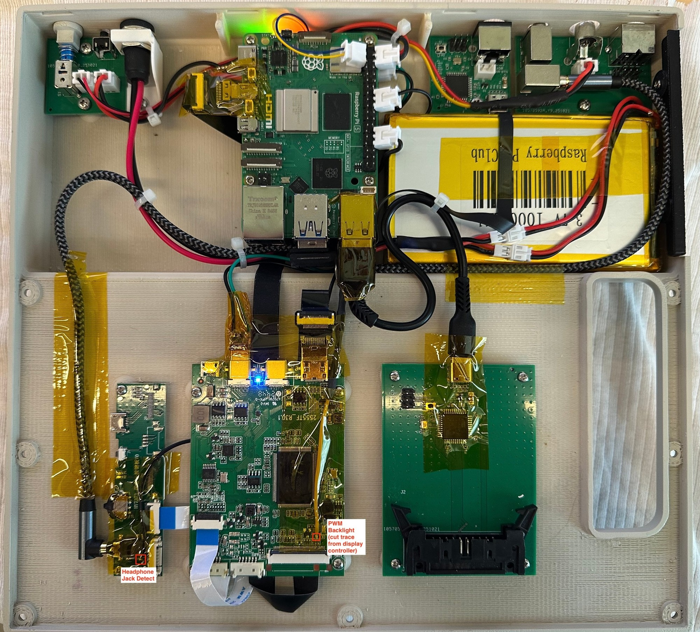
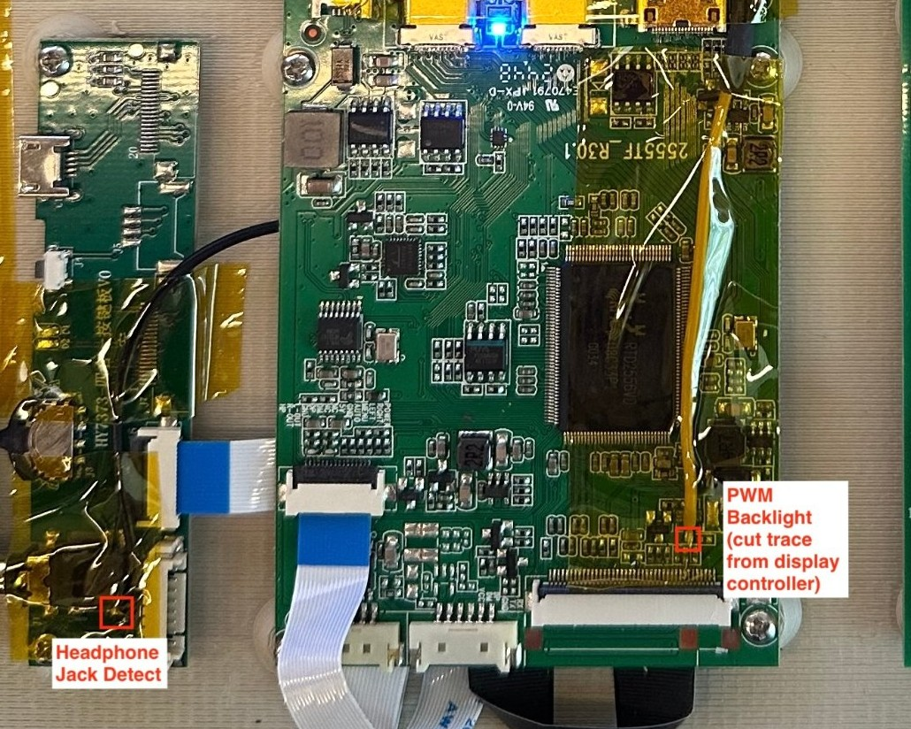
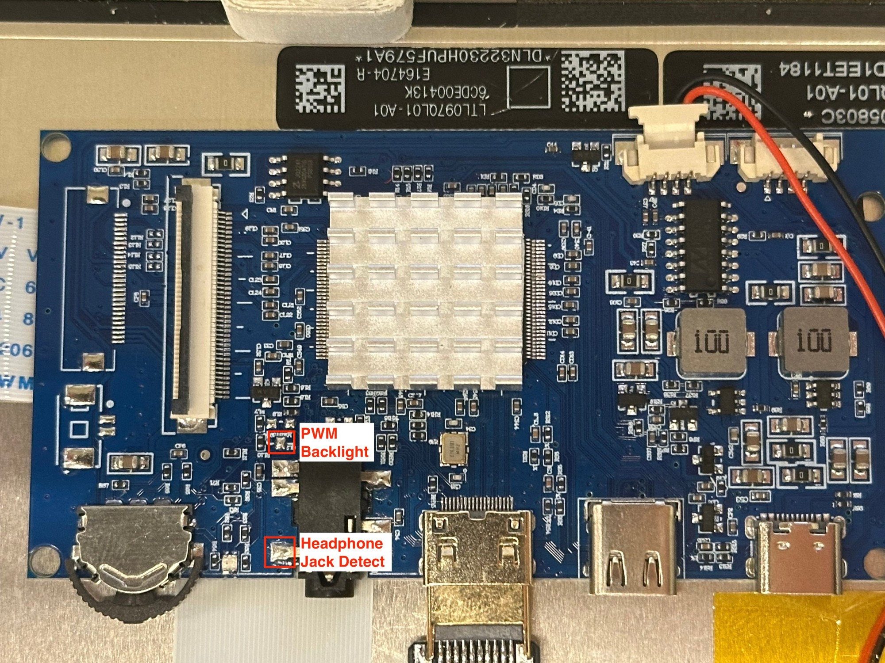

# BookMac — Components List & Wiring

Applies to both units, the full-size BookMac and the BookMac Mini, unless a row says otherwise. Last updated 2026-10-25.



*Full-size BookMac, current layout. Top row, left to right: the rear power/reset board, the Raspberry Pi 5 (PiPower 5 underneath), the rear ADB and AV boards, and the battery packs. Bottom row: the display controller's control/audio board, the VS-RTD2556HC-V2 display controller and the keyboard controller. The red boxes mark the two display-controller modifications in §4.*

**Source tags**
- [P] [`rpi5-pinout.md`](rpi5-pinout.md): Pi pinout and configuration
- [G] [`pipower5-installation.md`](pipower5-installation.md): PiPower 5 installation
- [A] `pcb/rear-port-adb/rear-port-adb.sch` · [R] `pcb/rear-port-power/rear-port-power.sch` · [K] `pcb/keyboard/keyboard.sch` · [C] `pcb/keyboard-controller/keyboard-controller.sch`
- [S] Builder's notes: as-built facts not recorded in any design file
- [V] Vendor listings: VSDISPLAY 9.7" LCD + VS-RTD2556HC-V2 (Amazon ASIN B0C4F8XGK9) and VSDISPLAY 8 Ω 2 W speaker
- [ALPS] tech.alpsalpine.com product pages for SPPJ222200 / SPPJ223200

> **Hobbyist designs, reference only.** See the top-level README. Measure and check against your own parts before you solder or power anything.

## Before you build

1. **Rear power switch.** The rear power/reset board is drawn with S1 = ALPS SPPJ222200, a *latching* switch. The PiPower 5 needs a *momentary* button. Fit the momentary **ALPS SPPJ223200** instead (§3.3). The prototypes used the latching part with its latching pin removed by hand.
2. **Balance the battery packs before wiring them in series.** Measure each pack on its own. If the two differ by more than **50 mV**, charge each one separately with a single-cell (1S) LiPo charger to the same voltage, then measure again before connecting them (§3.2).
3. **Display controller modifications.** Backlight dimming and speaker/headphone switching need two changes to the display controller. Both can damage the controller if done carelessly. Read §4 before you start.

---

## 1. Components

### 1.1 Compute, display, audio, input

| Function | Full-size BookMac | BookMac Mini | Source |
|---|---|---|---|
| SBC | Raspberry Pi 5 | same | [P] |
| LCD | 9.7" iPad Retina panel, 2048 × 1536, **LTL097QL01-A01** | same model | [V][S] |
| Display controller | **VSDISPLAY VS-RTD2556HC-V2** (Realtek RTD2556). Mini-HDMI and USB-C inputs. The headphone jack and OSD switch are on a separate control/audio board on a cable. | **PCB800869** (Realtek RTD2556 family), 48 × 90 mm. The OSD switch and 3.5 mm jack are on the main board. | [V][S] |
| eDP adapter | TLT-iPAD3, supplied with the display controller | same | [S] |
| Controller power | USB-C from the PiPower 5 | same | [S] |
| Video | HDMI from the Pi | same | [S] |
| Backlight dimming | Controller's PWM output separated from the backlight DIM line; Pi GPIO12 drives DIM through 1 kΩ (§4.1) | same method | [S][P] |
| Speaker mount | 15 mm position | 15 mm position with a filler insert for a 10 mm speaker | [S] |
| Speakers | VSDISPLAY 8 Ω 2 W (3 W max), stereo, driven by the controller's amplifier | One 10 mm speaker, left channel only | [V][S] |
| Speaker connector | PH1.25 4-pin | PH1.25 4-pin | [S] |
| Headphone path | Controller audio out → jack on the control/audio board → short 3.5 mm cable → rear AV board. GPIO24 → jack detect switches speaker / headphones (§4.2). | Same circuit; jack on the PCB800869 | [S][P] |
| Touch | SingWon CTP V1.18B, USB HID ([AliExpress item 2255800416244761](https://www.aliexpress.us/item/2255800416244761.html)) | same | [P][S] |
| Composite out | Pi 5 J7 pads, `drm-rp1-vec` | same | [P] |
| USB devices on the Pi 5 | ADB converter, keyboard controller and touch controller, each on a slim USB-C cable. AreMe 90° USB-C female → USB-A male adapters (left- and right-angle) for clearance; the right-angle units have their metal housing slid off. | Same three devices on USB-C → USB-A cables; no adapters needed | [S] |

### 1.2 Power (both units)

| Function | Part | Notes |
|---|---|---|
| UPS / power path | SunFounder PiPower 5 | Female header desoldered; mounted under the Pi on standoffs, with the Pi on top. 5 V / 5 A out [G][S] |
| Cells | 2 × 3.7 V 10,000 mAh single-cell LiPo packs with built-in protection, PH2.0 connectors | 2S series [G]; observed capacity around 8 Ah [S]; balance first (§3.2) |
| Cell mounting | Full-size: packs VHB-taped together, then to the bottom case. Mini: on a printed tray next to the keyboard controller. | [S] |
| DC in | 5.5 × 2.1 mm barrel, 12 V, ≥ 18 W (36 W recommended) | [G] |
| DC jack | Tugermoola DC-022D 5.5 × 2.1 mm female, threaded panel mount ([Amazon B0DX1ZQ84K](https://www.amazon.com/dp/B0DX1ZQ84K)), seated flush in a printed holder | [S] |
| Pi feed | PiPower 5 5 V → Pi pin 4 / pin 6 | [G] |
| Display controller feed | PiPower 5 USB-C → display controller USB-C | [S] |
| Power button | Rear board S1 (momentary, §3.3) → PiPower 5 button header | [R][S] |

PiPower 5 settings [G]: DIP 0/0 (5 W charge) · SDSIG = PI3V3 · Default ON/OFF = OFF · I2C power = SHUT · `POWER_OFF_ON_HALT=1`.

Observed runtime on battery: about 3–6 h [S].

### 1.3 Pi-side passives [P]

| Value | Placement |
|---|---|
| 1 kΩ | Series, GPIO12 → backlight DIM point |
| 4.7 kΩ | DIM point → GND (optional; keeps the backlight dark at boot) |
| 1 kΩ | Series, GPIO24 → headphone-jack detect point |

### 1.4 Rear-port ADB converter [A]

| Ref | Part / value |
|---|---|
| U1 | ATmega32U4-AU, TMK firmware `firmware/adb/unimap.hex` |
| Y1, C3, C4 | 16 MHz FL1600087; 20 pF × 2 |
| C1 / C2 / C5–C9 | 10 µF / 1 µF UCAP / 0.1 µF × 5 |
| R1 | 10 kΩ HWB (PE2) pull-down. The HWBE fuse must stay unprogrammed. |
| R3 | 10 kΩ RESET pull-up |
| R4, R5 | 22 Ω USB series |
| R6 | 1 kΩ ADB DATA pull-up |
| R2, R7 | **5.1 kΩ** CC pull-downs (the schematic text reads "5.1") |
| F1 / D1 | Littelfuse 0466.500NRHF / Nexperia PRTR5V0U2X |
| J1 / J2 / J3 | USB-C TYPE-C-31-M-12 / Mini-DIN 4 TE 5749181-1 / JST XH 2-pin |
| JP1 / S1 | 2 × 3 ISP header / KMR211G reset switch |

### 1.5 Rear power/reset board [R]

| Ref | Part | Notes |
|---|---|---|
| S1 | **ALPS SPPJ223200**, DPDT momentary | The schematic shows SPPJ222200 (latching); fit SPPJ223200 (§3.3) |
| S2 | E-Switch TL1105RF160Q, SPST-NO tactile | Reset |
| POWER, RESET | JST XH 2-pin | |

### 1.6 Internal keyboard [K] and controller [C]

- **Keyswitches:** Cherry MX Low Profile footprint. As purchased: "CHERRY MX LOW PROFILE RGB … Silver Switch 3 Pin Linear" ([AliExpress item 3256806141913378](https://www.aliexpress.us/item/3256806141913378.html)) [S].
- **Stabilizers:** Gateron low-profile plate-mounted [S].
- **Keyboard PCB:** 58 switches, 58 × 1N4148W-7-F diodes, 5 × 14 matrix (14/14/13/12/5 keys per row). JP1 is a row of 20 through-holes at 2.54 mm pitch, with pins 1 and 20 labelled on the silkscreen.
- **Controller PCB:** ATmega32U4, same core as §1.4, R2/R7 = 5.1 kΩ. J2 is a TE 5499786-4 2 × 10 latching IDC header.
- **Ribbon:** a pre-built 20-pin IDC flat ribbon cable, 2.54 mm connector pitch, 300 mm long. The IDC connector at one end plugs into the controller's J2. The other connector is cut off and the conductors are soldered into the keyboard's JP1 holes. Pin order must match end to end (§3.5).
- **Firmware:** QMK, `firmware/keyboard/` (see its README) [C].

### 1.7 Fasteners and mounting [S]

| Location | Screw (pan Phillips, 304 stainless) | Insert (knurled heat-set) | Notes |
|---|---|---|---|
| Main case | M3 × 5 mm | M3 × 3 mm | |
| Keyboard PCB | M3 × 4 mm | M3 × 3 mm | Tips filed down about 1 mm so they don't dimple the bottom case |
| Power-switch PCB, ADB PCB, AV board | M3 × 4 mm | M3 × 3 mm | |
| Display controller PCB, keyboard controller PCB | M2 × 4 mm | M2 × 3 mm | |
| Screen (display) mounting | M2 (length not recorded) | M2 × 3 mm | Same M2 inserts as the controller PCBs |
| PiPower 5 | M2.5 hex brass standoffs (11 mm body + 6 mm male thread) | M2.5 × 3 mm | 2 mm of thread filed off so it doesn't reach through the bottom case; the Pi 5 stacks on the PiPower 5 |

### 1.8 Enclosure and decals

- **Full size:** `enclosure/bookmac/`, STEP model plus one STL per part; also on [Thingiverse thing 7426168](https://www.thingiverse.com/thing:7426168).
- **Mini:** `enclosure/bookmac-mini/`, STEP model plus one STL per part.
- See [`enclosure/README.md`](../enclosure/README.md) for parts and sizes, and [`decals/README.md`](../decals/README.md) for the keycap decals.

### 1.9 Custom PCBs

EAGLE 9.7 files, exported from Autodesk Fusion. Gerbers are attached to the GitHub Release `pcb-2025-09`.

| Board | Revision | Files |
|---|---|---|
| Keyboard PCB | v29, 2025-08-21 | `.sch`, `.brd`, BOM, CPL |
| Keyboard Controller | v28, 2025-09-15 | `.sch`, `.brd`, BOM, CPL, part list |
| Rear Port ADB | v50, 2025-09-15 | `.sch`, `.brd`, BOM, CPL, part list |
| Rear Port Power | v36, 2025-09-16 | `.sch`, `.brd`, BOM, CPL, part list |
| Rear Port AV | v21, 2025-09-16 | `.brd`, BOM, CPL, part list (no `.sch`) |

The keyboard BOM labels the switches "Cherry MX2B-L2NA".

### 1.10 Rear Port AV board (v21)

| Ref | Part | Function |
|---|---|---|
| J3 | TE 1658998-1, Mini-DIN 8, right-angle | Printer-style port |
| JP1 | 2 × 4 pin header, 2.54 mm | Breakout for J3 |
| J7 | Same Sky RCJ-011 RCA jack | Composite video out |
| J1 | JST XH 2-pin (B2B-XH-A) | Composite feed in from the Pi 5 J7 pads |
| J4, J6 | Same Sky SJ1-3533NS 3.5 mm TRS | Headphone pass-through |

Nets, from the `.brd` (there is no schematic):
- **Composite:** J7 pad 2 (RCA centre) ↔ **J1 pad 2**. Ground pour: J7 sleeve pads ↔ **J1 pad 1**, plus the J3 shell and the J4/J6 shield pads.
- **J3 ↔ JP1:** pin *n* ↔ pin *n*, for pins 1–8.
- **J4 ↔ J6:** pin 1↔1, 2↔2, 3↔3. A short 3.5 mm cable runs from the display controller's headphone jack to the inner jack; the outer jack is exposed at the case.

---

## 2. System block diagram (full-size BookMac)

```
           12 V barrel jack
                 |
   +-------------v------------------------------------+
   |              SunFounder PiPower 5                |
   |  BAT +/- <-- 2S pack       button hdr <-- S1     |
   |  I2C hdr (SDA,SCL)         HAT pin1 <-- NOT WIRED|
   |  5 V out ----------+       USB-C out ---------+  |
   +--------|-|---------|--------------------------|--+
           SDA SCL     5V/GND                      |
   +--------v-v---------v-------------+            |
   |         Raspberry Pi 5           |            v
   |  HDMI --------------------------------> VS-RTD2556HC-V2 --TLT-iPAD3--eDP--> 9.7" LCD
   |  GPIO12 --1k--(4.7k to GND)-----------> backlight DIM (separated from controller PWM)
   |  GPIO24 --1k--------------------------> headphone-jack detect
   |                                  |        |-- amp --> 2 x 8 ohm 2 W speakers
   |                                  |        '-- audio out --> rear headphone jack
   |  USB --- SingWon touch           |
   |  USB --- rear ADB converter (TMK)|
   |  USB --- internal kbd controller |
   |  J7  --- composite (rear RCA)    |
   +----------------------------------+
```

The Mini differs in the display-controller block (PCB800869, with the jack and OSD switch on the board) and has one 10 mm speaker on the left channel.

---

## 3. Wiring detail

### 3.1 Pi 5 header [P]

| Pin | Signal | To |
|:-:|---|---|
| 3 | SDA1 | PiPower 5 I2C SDA |
| 4 | 5 V | PiPower 5 5 V out |
| 5 | SCL1 | PiPower 5 I2C SCL |
| 6 | GND | Common ground |
| 18 | GPIO24 | 1 kΩ → headphone detect (LOW = speaker off) |
| 32 | GPIO12 | 1 kΩ → backlight DIM |
| 1 | 3.3 V | **Pending:** → PiPower 5 HAT pin 1 (SDSIG shutdown sense; see [G]) |

### 3.2 Battery (2S) [G]

```
Pack A + ────────────────────── PiPower 5 BAT +
Pack A − ──┐
           ├─ series junction (no mid-tap to the board)
Pack B + ──┘
Pack B − ────────────────────── PiPower 5 BAT −
```

**Balance before connecting.** In a series pack without balance wiring, the two cells charge and discharge together, so any starting difference persists. The pack with the lower voltage reaches its protection cut-off first, and the higher one is pushed toward overcharge.

1. Measure each pack's voltage on its own with a multimeter.
2. If they differ by more than 50 mV, charge each pack separately with a single-cell (1S) LiPo charger to the same voltage. Charging both to full (4.20 V) is the simplest way.
3. Let them rest, measure again, and connect them in series only when they are within 50 mV.
4. Check the pack voltages every few months. Rebalance if they drift apart [G].

### 3.3 Rear power/reset board [R]

```
POWER-2 ── S1-4        RESET-2 ── S2-1
POWER-1 ── S1-5        RESET-1 ── S2-2
S1-3 stub, S1-1/2/6 unconnected, S1 shield to GND symbol
```

**Momentary switch: ALPS SPPJ223200.** This is the momentary member of the same SPPJ2 series as the SPPJ222200 in the schematic [ALPS]. ALPS lists the same 2 poles, the same 2.5 mm travel (3.5 mm total) and 3 ± 1.5 N operating force, the same 12.0 × 7.2 × 9.6 mm body and PC-board terminals, and the same 0.2 A / 30 VDC rating. The only listed difference is momentary versus latching operation. ALPS publishes the terminal layout only as images. Before soldering, check with a meter:
- pins 4–5 are open at rest and closed when pressed (the pair POWER uses);
- the pin and peg pattern fits the existing holes.

SPPJ3 parts are latching and are not an alternative.

### 3.4 Rear ADB port [A]

```
Mini-DIN 4 (J2)        ATmega32U4
 1 DATA ──┬──────────── PD0
          └─ R6 1k ─── +5V
 2 PSW  ─────────────── J3-1 (J3-2 = GND)   optional input, not used
 3 +5V  ─────────────── +5V
 4 GND  ─────────────── GND

USB-C: VBUS ─ F1 ─ +5V · D−/D+ ─ 22 Ω ─ U1 · CC1/CC2 ─ 5.1 kΩ ─ GND · D1 ESD on D±
```

### 3.5 Internal keyboard ↔ controller [K][C]

| Pin (both ends) | Keyboard net | Controller net | ATmega32U4 pin |
|:-:|---|---|---|
| 1–8 | cols 1–8 | COL-0…COL-7 | PB4, PB5, PB6, PC6, PC7, PF6, PF7, PB0 |
| 9–11 | cols 9–11 | COL-8…COL-10 | PD1, PD2, PD3 |
| 12 | col 12 | COL-11 | PD5 |
| 13 | col 13 | COL-12 | PD4 |
| 14 | col 14 | COL-13 | PD6 |
| 15–19 | rows 1–5 | ROW-0…ROW-4 | PE6, PF5, PF0, PF1, PF4 |
| 20 | NC | NC | — |

**Pins 1–20 must match end to end.** The mapping is 1:1. Pin *n* at the keyboard's JP1 must reach pin *n* of the controller's J2 IDC header. To get this right:
- Find conductor 1. On a pre-built IDC ribbon it is usually marked with a red stripe, and it lands on the pin marked with a triangle on the remaining IDC connector. Confirm with a meter rather than trusting the stripe.
- The keyboard's JP1 has pins 1 and 20 labelled on the silkscreen. Solder conductor 1 into hole 1 and work across in order to conductor 20 in hole 20. Don't twist or flip the ribbon.
- Before you power it, plug the IDC connector into the controller. Check continuity from each JP1 hole to the matching J2 pin, and check that neighbouring conductors aren't shorted.
- Add strain relief at the soldered end. The prototypes used Kapton tape.

A reversed ribbon puts columns on row pins. The keyboard then produces wrong keys or none, and no single key can tell you why.

**Fn layer** (QMK; see `firmware/keyboard/README.md`): the enter-legend key on the bottom row (R4C12) toggles the Fn layer. Right option sends Right Alt.

| Physical key | Base layer | Fn layer |
|---|---|---|
| enter-legend (R4C12) | Fn toggle | Fn toggle (back to base) |
| right option (R4C13) | Right Alt | Right Alt |
| ` / ~ | ` | Esc |
| 1 … = | 1 … = | F1 … F12 |
| delete | Backspace | Delete |
| W / A / S / D | letters | ↑ ← ↓ → |
| command | Left GUI | Left Ctrl |

Return is at R2C12. The enter-legend keycap is the Fn toggle, not a second Enter.

---

## 4. Display controller modifications

The Pi controls backlight brightness and speaker/headphone switching directly, through the `brightness-control` and `volume-control` software. Both need a small change to the display controller.

> **Risk of damage.** These boards have fine-pitch parts and thin traces. Too much heat lifts pads. A slip can short a scaler pin. Feeding the Pi's GPIO into a line the controller is still driving can damage the controller, the Pi, or both. The backlight connector also carries the LED supply, which is far above 3.3 V: never probe it with anything connected to the Pi. Work with the board unpowered unless a step says otherwise. Use flux and a fine tip, and test each step before you go on. The points marked in the photos are where they were on the builder's boards; other revisions of the same boards may differ, so locate and test on your own board.

| | Full-size BookMac | BookMac Mini |
|---|---|---|
| Display controller | VSDISPLAY VS-RTD2556HC-V2 | PCB800869 |
| Backlight change | Cut the PWM trace from the controller (marked). Desoldering the PWM transistor may also be required. | The PWM transistor position was unpopulated on the boards received. Connect at the marked point. |
| Headphone detect point | On the separate control/audio board, at the 3.5 mm jack (marked) | On the main board, at the 3.5 mm jack (marked) |
| Photo |  |  |

### 4.1 Backlight dimming

The goal is for the backlight DIM/PWM input to be driven only by the Pi's GPIO12 (hardware PWM), with the Realtek controller's own PWM output disconnected from it.

**Locate:**
1. Find the DIM (PWM) input. It is on the TLT-iPAD3 adapter or on the backlight side of the controller, often labelled PWM, ADJ or DIM.
2. With the board unpowered, use continuity mode to trace it back toward the Realtek controller. Find the trace, series resistor or transistor that connects the controller's PWM output to DIM. That is where it gets separated.

**Test before cutting:**
1. Power the board with the panel connected. Measure DC voltage at the candidate point while you change brightness in the controller's OSD from minimum to maximum. A multimeter shows a PWM signal as an average voltage, so the reading should move with brightness. If it doesn't, you have the wrong line.
2. Note the voltage at maximum brightness. On the full-size unit, the undriven DIM line measured about 4.1 V [P]. That is above the Pi's 3.3 V, which is why the series resistor is required.

**Separate:**
1. Power off. Cut the trace, or remove the series part. On the full-size VS-RTD2556HC-V2, the PWM transistor may need to be desoldered.
2. Use continuity mode to confirm DIM no longer connects to the controller side.
3. Power on and change OSD brightness. The voltage on the DIM side should no longer change.

**Connect:**
1. Wire Pi GPIO12 (pin 32) to the DIM point through a **1 kΩ** series resistor. Never connect it directly. Optionally add **4.7 kΩ** from DIM to GND so the backlight stays dark until the software starts.
2. Configure the Pi as in [`rpi5-pinout.md`](rpi5-pinout.md): `dtoverlay=pwm,pin=12,func=4` and `gpio=12=op,dl`.
3. Test with `brightness-control` at a low setting first.

### 4.2 Speaker / headphone switching (jack detect)

The controller mutes its speakers when the 3.5 mm jack's detect contact shows a plug is inserted. The Pi imitates that. GPIO24 LOW pulls the detect line to ground (as if a plug were in, so the speakers turn off). GPIO24 HIGH releases it (speakers on).

**Locate:**
1. With the board unpowered, find the jack's detect (switch) pin. Check continuity between the jack's pins with and without a plug inserted: the detect contact is the one whose connection changes when the plug goes in.
2. Power on and measure the detect pin's voltage with and without a plug. It should change state; on the builder's units it sat at about 0.8 V with no plug [P].

**Test before soldering:**
1. Play audio through the speakers.
2. Briefly connect the detect point to GND **through a 1 kΩ resistor**. The speakers should mute; remove the resistor and they should come back. If they don't, you have the wrong pin.

**Connect:**
1. Wire Pi GPIO24 (pin 18) to the detect point through a **1 kΩ** series resistor.
2. In `volume-control`, set `gpio_active_high: false` for this wiring [P].
3. Test switching both ways in software, then with a real plug in the rear headphone jack.

---

## 5. Open items

1. Pending wire: Pi pin 1 (3.3 V) → PiPower 5 HAT pin 1, the shutdown-sense path [G].
2. AV board: which SJ1-3533NS pins (1–3) are tip, ring and sleeve.
3. [P] mentions a device on the "LCD controller" at I2C address 0x5C, the same address as the PiPower 5. Its source and wiring are not documented.

---

## 6. Schematic notes for the next revision

| File | Item |
|---|---|
| [A] | R2/R7 value text "5.1" → "5.1k" |
| [A][C] | R4/R5 "22" → "22R"; C1 10 µF on 0402 |
| [C] | Delete the dangling COL-14 label on PD7 |
| [R] | Change S1 to SPPJ223200 (momentary) |
| [K] | JP1 library description says "10 Position" |
